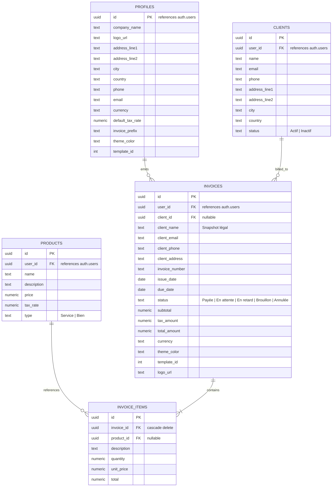

# IziFacture — Documentation Projet & Guide d'Architecture

> **Note à l'attention des modèles IA et développeurs** : Ce document constitue la référence centrale du projet **IziFacture**. Consultez-le impérativement avant toute intervention pour appréhender l'architecture, le modèle de données, les conventions techniques et les fonctionnalités existantes.

---

## 1. Présentation & Mission de l'Application

**IziFacture** est une application SaaS de facturation moderne, intuitive et hautement personnalisable conçue pour les freelances, créateurs, indépendants et TPE/PME.

L'objectif d'IziFacture est de simplifier l'émission et le suivi des factures grâce à :
- Une interface rapide, réactive et esthétique.
- Une personnalisation poussée des factures (choix parmi **10 modèles graphiques de factures**, palettes de couleurs d'accentuation, sélection de devises).
- Une génération et un export PDF haute fidélité pour impression et téléchargement instantanés.
- Un backend complet, sécurisé et multi-tenant propulsé par **Supabase** (PostgreSQL, Auth, Row Level Security, Storage).

---

## 2. Fonctionnalités Implémentées

### A. Authentification & Profils Multi-Tenant (Supabase Auth)
- **Inscription & Connexion** : Pages `/register` et `/login` modernes avec validation et gestion des erreurs utilisateur.
- **Trigger SQL automatique (`handle_new_user`)** : Lors de chaque inscription (`auth.users`), un profil d'entreprise par défaut est instantanément inséré dans la table `profiles`.
- **Session & Header interactif** : Affichage dynamique du nom d'entreprise, email et menu déroulant avec déconnexion (`signOut`).
- **Route d'échange OAuth / Email** : `/auth/callback` pour gérer les tokens de confirmation.

### B. Gestion des Clients (`/clients`)
- **CRUD complet** : Ajout, consultation, modification et suppression de clients.
- **Statistiques en direct** : Calcul automatique du chiffre d'affaires cumulé facturé par client à partir des factures émises.
- **Recherche instantanée** : Filtrage par nom d'entreprise, adresse email ou numéro de téléphone.
- **Gestion des statuts** : Badges `Actif` et `Inactif`.

### C. Catalogue de Produits & Services (`/products`)
- **CRUD complet** : Création, édition et suppression de prestations.
- **Types d'articles** : Distinction entre `Service` (prestation intellectuelle, régie, etc.) et `Bien` (produit physique ou matériel).
- **Gestion tarifaire** : Prix unitaire HT et taux de TVA paramétrable par article.
- **Filtres rapides** : Recherche textuelle et boutons de filtrage (`Tous`, `Service`, `Bien`).

### D. Créateur de Factures Personnalisées (`/invoices/new`)
- **Pré-remplissage Émetteur** : Chargement automatique des coordonnées de l'entreprise depuis `profiles`.
- **Sélection Client Assistée** : Menu déroulant pour sélectionner un client existant avec report automatique des adresses et contacts.
- **Lignes d'Articles Intelligentes** : Sélecteur de produits du catalogue pour auto-remplir désignation et prix unitaire, ou saisie manuelle libre.
- **Calculateur Fiscal Dynamique** : Calcul automatique en direct du sous-total HT, du montant de TVA et du total TTC.
- **Gestion du Logo (Supabase Storage)** : Upload d'image (PNG/JPEG/WEBP) directement sur le bucket de stockage Supabase `logos` avec URL publique persistante.
- **Styling en Temps Réel** :
  - Choix parmi **10 modèles de factures** (Classique, Moderne, Minimaliste, Audacieux, Élégant, Sidebar, Corporate, Créatif, Compact, Tech).
  - Sélection de la couleur d'accentuation (7 teintes soignées).
  - Choix de la devise (`€`, `$`, `FCFA`).
- **Aperçu & Impression PDF** : Modal d'aperçu dynamique (`PreviewInvoice`) et export PDF direct via `react-to-print`.
- **Persistance Atomique** : Enregistrement complet de la facture (`invoices`) et de toutes ses lignes d'articles (`invoice_items`) sur Supabase.

### E. Suivi & Gestion des Factures (`/invoices`)
- **Liste complète des factures** émises par l'utilisateur connecté.
- **Filtrage par statut** : `Tous`, `Payée`, `En attente`, `En retard`.
- **Actions rapides sur les statuts** : Marquer une facture en un clic comme *Payée*, *En attente* ou *En retard*.
- **Aperçu & Téléchargement PDF** : Réouverture de la modale de visualisation et réimpression PDF pour n'importe quelle facture existante.
- **Suppression sécurisée** : Suppression avec cascade automatique sur les lignes d'articles.

### F. Tableau de Bord & Indicateurs KPI (`/dashboard`)
- **Total Encaissé** : Somme en temps réel des factures au statut `Payée`.
- **En Attente** : Montant total des factures émises en attente de règlement.
- **En Retard** : Montant des factures dont la date d'échéance est dépassée.
- **Clients Actifs & Volume** : Nombre de clients actifs et total des factures créées.
- **Dernières Factures** : Tableau des transactions les plus récentes avec accès rapide au PDF.

### G. Vitrine & Marketing (`/`)
- Landing page de présentation produit avec design épuré, démonstration des fonctionnalités, tarification et pied de page complet.

### H. Skeleton Loaders & UX Réactive
- **Design système de skeleton** : Composant de base [skeleton.tsx](file:///c:/Users/GLOBAL%20REUSSITE/Documents/IZISAAS/projets/IziFacture/src/components/ui/skeleton.tsx) avec pulsation fluide (`animate-pulse`) et teintes douces `slate-200/70`.
- **Composants dédiés haute fidélité** :
  - [DashboardSkeleton.tsx](file:///c:/Users/GLOBAL%20REUSSITE/Documents/IZISAAS/projets/IziFacture/src/components/skeletons/DashboardSkeleton.tsx) : 4 cartes KPI + tableau des factures récentes.
  - [InvoicesSkeleton.tsx](file:///c:/Users/GLOBAL%20REUSSITE/Documents/IZISAAS/projets/IziFacture/src/components/skeletons/InvoicesSkeleton.tsx) : barre de recherche, filtres et tableau responsive.
  - [ClientsSkeleton.tsx](file:///c:/Users/GLOBAL%20REUSSITE/Documents/IZISAAS/projets/IziFacture/src/components/skeletons/ClientsSkeleton.tsx) : recherche, colonnes complètes (coordonnées, total facturé, statut, actions).
  - [ProductsSkeleton.tsx](file:///c:/Users/GLOBAL%20REUSSITE/Documents/IZISAAS/projets/IziFacture/src/components/skeletons/ProductsSkeleton.tsx) : recherche, sélecteur de types et grille tarifaire.
  - [InvoiceNewSkeleton.tsx](file:///c:/Users/GLOBAL%20REUSSITE/Documents/IZISAAS/projets/IziFacture/src/components/skeletons/InvoiceNewSkeleton.tsx) : studio complet (champs, logo, cartes émetteur/client, lignes d'articles, totaux, sidebar).
- **Double couverture technique** :
  - *Streaming instantané App Router* : fichiers `loading.tsx` affichés dès la transition de route.
  - *États asynchrones client* : remplacement des spinners bloquants dans les pages pendant les appels Supabase.

---

## 3. Structure des Fichiers

```text
IziFacture/
├── .env.local                    # Variables d'environnement Supabase (URL + Anon Key)
├── AGENTS.md                     # Directives pour Next.js 16+
├── GEMINI.md                     # Documentation centrale du projet (ce fichier)
├── package.json                  # Dépendances et scripts de build
├── tsconfig.json                 # Configuration TypeScript
├── public/                       # Assets publics et images statiques
└── src/
    ├── middleware.ts             # Middleware Next.js pour session refresh Supabase
    ├── app/
    │   ├── globals.css           # Styles globaux Tailwind CSS v4 & variables de thème
    │   ├── layout.tsx            # Root layout HTML
    │   ├── (auth)/               # Groupe de routes d'authentification
    │   │   ├── layout.tsx        # Layout centré avec fond dégradé et blur glassmorphism
    │   │   ├── login/page.tsx    # Page de connexion
    │   │   └── register/page.tsx # Page d'inscription (création compte + profil)
    │   ├── auth/
    │   │   └── callback/route.ts # Route handler pour échange de code Supabase
    │   ├── (dashboard)/          # Espace d'administration SaaS
    │   │   ├── layout.tsx        # Shell du dashboard (Sidebar + Header + Main)
    │   │   ├── dashboard/page.tsx# Vue d'ensemble avec KPIs et dernières factures
    │   │   ├── dashboard/loading.tsx # Fallback skeleton streaming Next.js
    │   │   ├── clients/page.tsx  # Gestion des clients (CRUD, stats, filtres)
    │   │   ├── clients/loading.tsx # Fallback skeleton streaming Next.js
    │   │   ├── products/page.tsx # Catalogue produits & services (CRUD, filtres)
    │   │   ├── products/loading.tsx # Fallback skeleton streaming Next.js
    │   │   ├── invoices/page.tsx # Liste de toutes les factures (filtres, statuts, PDF)
    │   │   ├── invoices/loading.tsx # Fallback skeleton streaming Next.js
    │   │   ├── invoices/new/page.tsx # Studio de création de facture
    │   │   └── invoices/new/loading.tsx # Fallback skeleton streaming Next.js
    │   └── (marketing)/          # Espace public / vitrine
    │       ├── layout.tsx        # Header marketing avec liens Auth + Footer
    │       └── page.tsx          # Landing page
    ├── components/
    │   ├── invoices/
    │   │   └── PreviewInvoice.tsx# Composant moteur de rendu des 10 templates de facture
    │   ├── layout/
    │   │   ├── header.tsx        # Header du dashboard (Avatar, profil Supabase, logout)
    │   │   └── sidebar.tsx       # Navigation latérale principale
    │   ├── skeletons/            # Skeleton loaders dédiés (formes fidèles par page)
    │   │   ├── DashboardSkeleton.tsx
    │   │   ├── InvoicesSkeleton.tsx
    │   │   ├── ClientsSkeleton.tsx
    │   │   ├── ProductsSkeleton.tsx
    │   │   └── InvoiceNewSkeleton.tsx
    │   └── ui/                   # Composants d'interface (shadcn / Base UI)
    │       ├── avatar.tsx
    │       ├── badge.tsx
    │       ├── button.tsx
    │       ├── card.tsx
    │       ├── dialog.tsx
    │       ├── dropdown-menu.tsx
    │       ├── input.tsx
    │       ├── label.tsx
    │       ├── select.tsx
    │       ├── separator.tsx
    │       ├── sheet.tsx
    │       ├── skeleton.tsx
    │       └── table.tsx
    ├── lib/
    │   ├── utils.ts              # Utilitaire de fusion de classes (clsx + tailwind-merge)
    │   ├── services/             # Couche d'accès aux données Supabase
    │   │   ├── clients.ts        # Service gestion clients & métriques de facturation
    │   │   ├── products.ts       # Service catalogue produits & services
    │   │   ├── invoices.ts       # Service factures, lignes d'articles & KPI dashboard
    │   │   └── profile.ts        # Service profil entreprise & upload logo (Storage)
    │   └── supabase/             # Initialisation et clients SDK Supabase
    │       ├── client.ts         # Client Browser (createBrowserClient)
    │       ├── server.ts         # Client Server pour Server Actions / SSR (createServerClient)
    │       └── middleware.ts     # Mise à jour et rafraîchissement des cookies de session
    └── types/
        └── database.types.ts     # Types TypeScript générés automatiquement depuis Supabase
```

---

## 4. Technologies Utilisées

| Domaine | Technologie | Rôle & Justification |
| :--- | :--- | :--- |
| **Framework Web** | `Next.js 16.3.3 (App Router)` | Rendu hybride SSR/CSR, routage déclaratif, performances avec Turbopack. |
| **Bibliothèque UI** | `React 19.2.8` | Dernières API React, hooks réactifs, transitions. |
| **Langage** | `TypeScript 5` | Typage strict de bout en bout, élimination des erreurs à la compilation. |
| **Base de Données** | `PostgreSQL 17 (Supabase)` | Base relationnelle transactionnelle hébergée sur Supabase (`eu-west-1`). |
| **Sécurité Données** | `Supabase Row Level Security (RLS)` | Isolation totale des données : chaque utilisateur n'accède qu'à ses ressources via `auth.uid() = user_id`. |
| **Stockage Fichiers** | `Supabase Storage` | Bucket public/sécurisé `logos` pour la persistance des logos d'entreprise. |
| **SDK Supabase** | `@supabase/supabase-js`, `@supabase/ssr` | Standard officiel de gestion des sessions avec cookies pour App Router. |
| **Style & Design** | `Tailwind CSS v4` | Moteur CSS moderne basé sur des variables CSS natives et PostCSS. |
| **Composants UI** | `shadcn` + `@base-ui/react` | Primitives accessibles, hautement personnalisables et sans styles superflus. |
| **Icônes** | `lucide-react` | Bibliothèque d'icônes vectorielles cohérente et légère. |
| **Impression / PDF** | `react-to-print` | Rendu direct du DOM pour impression et export PDF fidèle aux styles CSS. |

---

## 5. Schéma de la Base de Données (PostgreSQL)



---

## 6. Décisions de Design & Choix d'Ingénierie

1. **Snapshots des données clients sur les factures** :
   - *Problématique* : Si un client change d'adresse ou d'email ultérieurement, les anciennes factures déjà émises ne doivent pas être rétroactivement altérées (obligation comptable).
   - *Solution* : Lors de la création d'une facture, les champs `client_name`, `client_email`, `client_phone` et `client_address` sont copiés directement dans la ligne de la table `invoices`.

2. **Primitives `@base-ui/react` vs Radix UI** :
   - Les composants `DialogTrigger` et `DropdownMenuTrigger` dans cette version de base-ui s'appuient sur la prop `render={<Button ... />}` (et non sur `asChild`).
   - `DropdownMenuLabel` s'appuie sur `MenuPrimitive.GroupLabel` de Base UI et nécessite impérativement d'être englobé dans un `<DropdownMenuGroup>` (fournisseur du `MenuGroupContext`).
   - Les composants `Select` transmettent `(value: string | null)` dans `onValueChange`, ce qui nécessite une vérification de nullité (`val && ...`).

3. **Cookies asynchrones Next.js 16+** :
   - Dans `src/lib/supabase/server.ts`, l'appel `cookies()` de `next/headers` est asynchrone (`await cookies()`). Ne jamais invoquer `cookies()` de façon synchrone.

4. **Esthétique SaaS Premium** :
   - Teinte dominante : Violet moderne (`violet-600` / `#8b5cf6`).
   - Angles adoucis (`rounded-2xl` et `rounded-3xl`) pour une allure moderne.
   - Micro-animations de hover (`hover:shadow-md`, `hover:-translate-y-0.5`).

---

## 7. Instructions Clés pour un Futur Modèle IA

Si vous êtes une IA amenée à reprendre ce projet :
1. **Règle absolue d'accueil** : Vérifiez toujours les règles utilisateur globales (dire *"Hello Boss!"* en ouverture de réponse).
2. **Respect de l'architecture existante** :
   - Ne réinventez pas les appels Supabase dans les composants : passez toujours par la couche de services dans [src/lib/services/](file:///c:/Users/GLOBAL%20REUSSITE/Documents/IZISAAS/projets/IziFacture/src/lib/services/).
   - Si une nouvelle table ou colonne est requise, mettez à jour le schéma PostgreSQL via le MCP Supabase (`execute_sql`), puis régénérez les types dans [src/types/database.types.ts](file:///c:/Users/GLOBAL%20REUSSITE/Documents/IZISAAS/projets/IziFacture/src/types/database.types.ts).
3. **Respect du Row Level Security (RLS)** :
   - Toutes les requêtes d'insertion doivent injecter le `user_id` de l'utilisateur connecté (`auth.uid()`).
4. **Vérification systématique de compilation** :
   - Toujours valider les modifications avec `npm run build` pour garantir qu'aucune régression TypeScript ou d'import Next.js n'a été introduite.
5. **Préserver `react-to-print`** :
   - Le composant [src/components/invoices/PreviewInvoice.tsx](file:///c:/Users/GLOBAL%20REUSSITE/Documents/IZISAAS/projets/IziFacture/src/components/invoices/PreviewInvoice.tsx) est le moteur de rendu PDF. Toute modification de props ou de structure doit rester compatible avec les 10 modèles graphiques.
